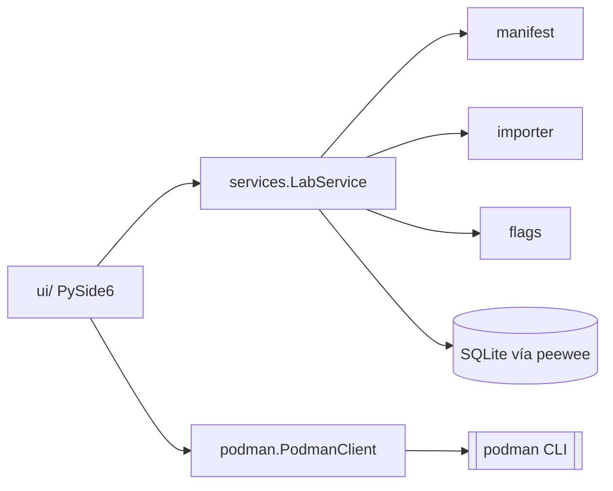
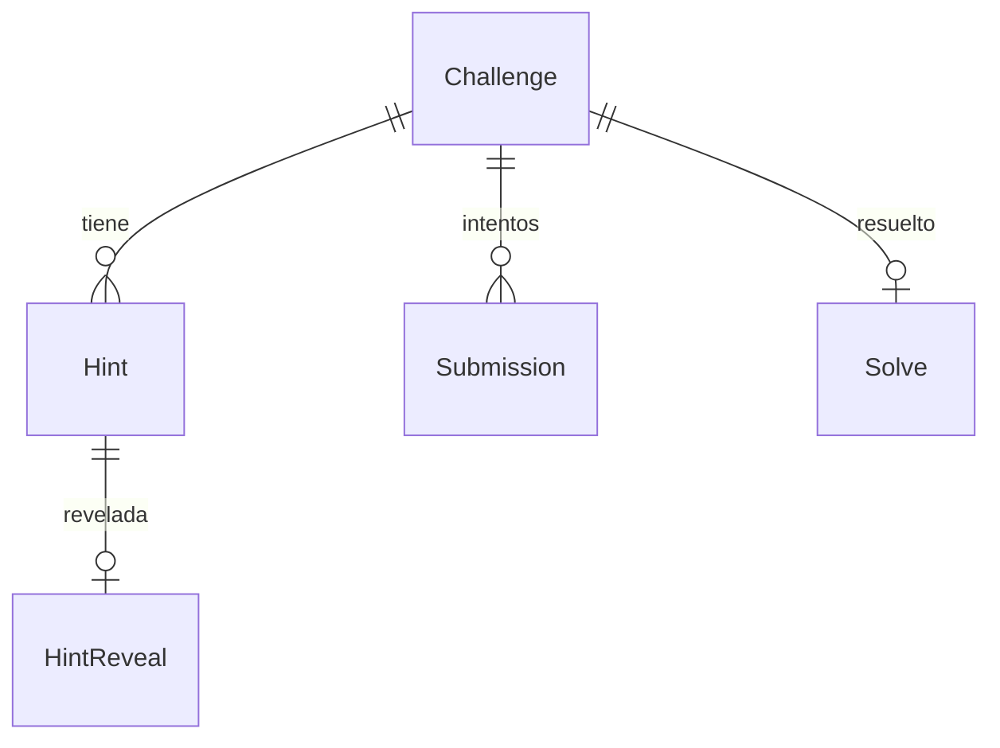

# Arquitectura

```
src/soclab/
├── cli.py                 # `soclab` (UI) · `soclab hash-flag` · `soclab validate`
├── config.py              # rutas por SO, SOCLAB_HOME
├── flags.py               # formato, normalización, hash scrypt, verificación
├── manifest.py            # parseo y validación estricta de challenge.toml
├── importer.py            # importación segura (ZIP/carpeta)
├── db.py                  # modelos peewee + SQLite (WAL, foreign keys)
├── services.py            # LabService: lógica de negocio (sin Qt)
├── podman.py              # cliente Podman (CLI, sin shell, endurecido)
├── containers/base/       # Containerfile de la imagen base compartida
├── builtin_challenges/    # 20 retos generados por scripts/generate_challenges.py
└── ui/                    # PySide6
    ├── app.py             # arranque, tema, carga de retos
    ├── main_window.py     # controlador: une servicio, Podman y widgets
    ├── models.py          # QAbstractTableModel + proxy de filtros
    ├── dashboard.py       # panel de progreso
    ├── detail.py          # detalle del reto
    ├── workers.py         # QThreadPool para tareas bloqueantes
    └── theme.py           # paleta y QSS
```

## Capas



- **`services` no importa Qt**: se prueba con pytest puro y es reutilizable desde la CLI.
- **La UI nunca bloquea**: las llamadas a Podman (build/run/stop/inspect) se ejecutan en un
  `QThreadPool` y sus resultados vuelven al hilo principal por señales en cola.
- **La BD solo se usa desde el hilo principal** (SQLite + peewee, conexión única).

## Modelo de datos



| Tabla | Propósito |
|---|---|
| `challenge` | Metadatos sincronizados desde `challenge.toml` (incluye `flag_hash`) |
| `hint` | Pistas (posición, texto, coste) |
| `hintreveal` | Pistas reveladas por el usuario |
| `submission` | Intentos: fecha y si fue correcto. **Nunca el valor enviado** |
| `solve` | Resolución con puntos otorgados (instantánea al resolver) |

Al arrancar, `LabService.sync()` hace *upsert* de los retos de `builtin_challenges/` y de
los importados **sin tocar el progreso**.

## Flags

1. Formato: `^SOC\{[^\s{}]{1,200}\}$` (prefijo insensible a mayúsculas).
2. Normalización: `strip()` + Unicode NFC + minúsculas (si `case_sensitive = false`).
3. Almacenamiento: `scrypt$N$r$p$sal$hash` (N=2¹⁴, r=8, p=1, sal de 16 bytes). scrypt es
   costoso a propósito para que leer el manifiesto no permita obtener la flag por fuerza
   bruta fácilmente. Los parámetros se acotan para que un manifiesto malicioso no agote
   memoria.
4. Verificación con `hmac.compare_digest` (tiempo constante).
5. Anti fuerza bruta: 2 s de espera tras cada intento fallido.

## Seguridad al importar

| Riesgo | Mitigación |
|---|---|
| Zip slip (`../`, rutas absolutas, `C:`) | Validación de cada entrada + `resolve().is_relative_to()` |
| Zip bomb | Máx. 50 MiB descomprimidos, 500 archivos, ratio ≤ 100 |
| Symlinks | Rechazados en ZIP y carpetas |
| Manifiesto malicioso | Esquema estricto, claves desconocidas rechazadas, tamaños acotados |
| Sobrescribir retos incluidos | Slugs de retos `builtin` reservados |
| Markdown con enlaces locales | Solo se abren enlaces `http(s)`; HTML de pistas escapado |
| Containerfile no confiable | Aviso al importar + endurecimiento obligatorio en `podman run` |
| Inyección de comandos | `subprocess` con lista de argumentos, sin `shell=True` |

## Retos incluidos y reproducibilidad

`scripts/generate_challenges.py` genera los 20 retos con semillas fijas. El test
`test_generator_is_deterministic` regenera todo y exige que coincida byte a byte con lo
versionado, y `tests/solvers.py` contiene una **solución independiente por reto** que
deriva la flag desde los artefactos y la verifica contra el `flag_hash`. Así CI garantiza
que todos los retos son resolubles.
